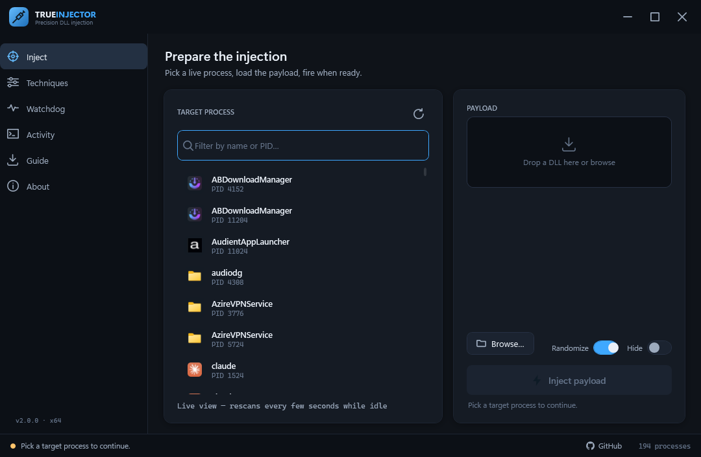
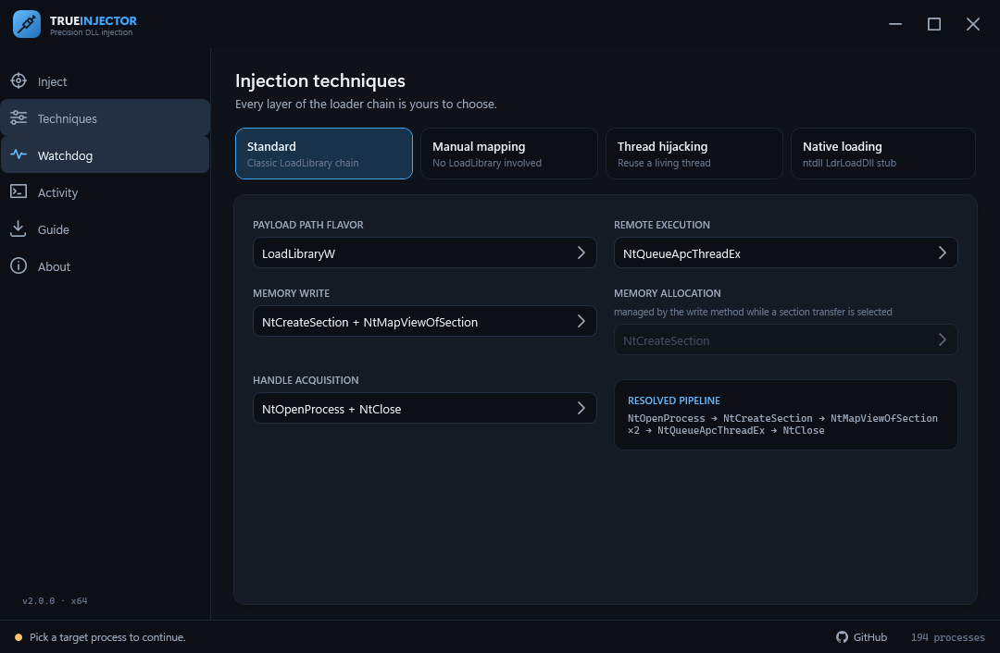
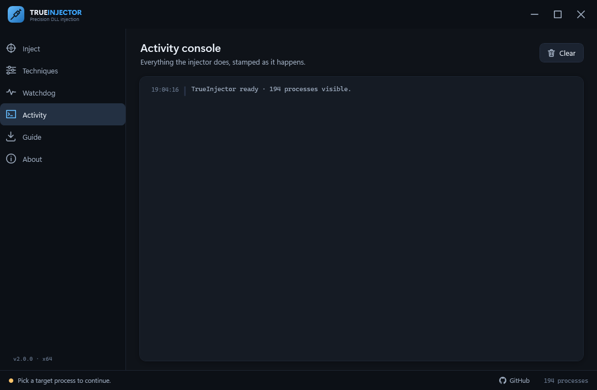
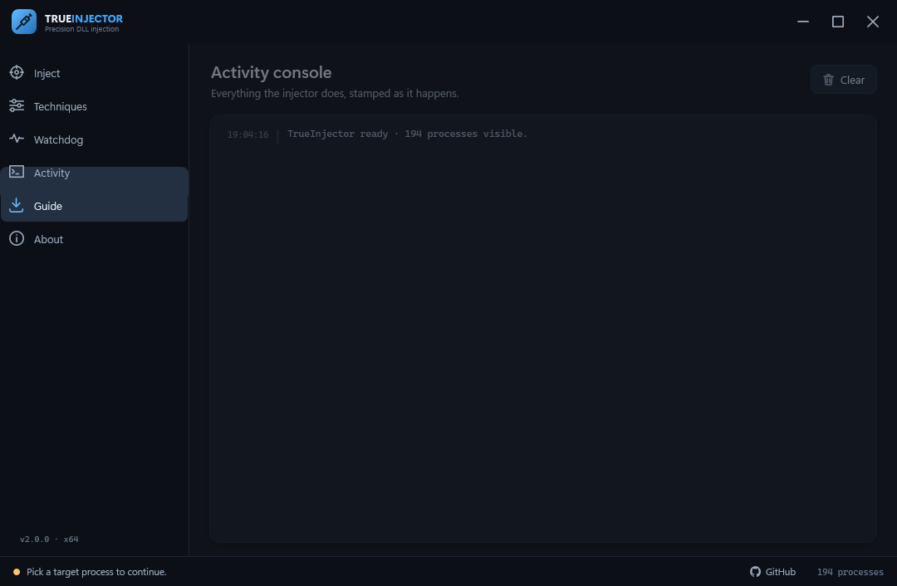
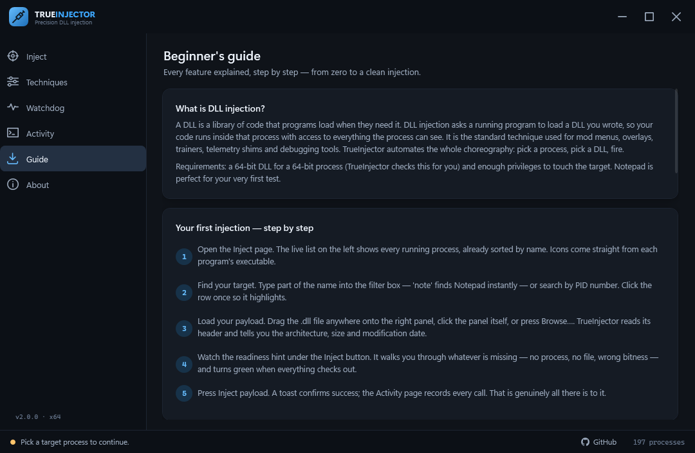

<div align="center">

# 💉 TrueInjector

**The precision DLL injector for Windows x64 — rebuilt from scratch on WPF**

*Load, map, hijack or natively inject any DLL into any running process in three clicks.*

[](../../releases/latest)
[](../../releases/latest)
[](#-getting-started)
[](#-injection-techniques-deep-dive)
[](LICENSE)
[](#-performance)

**[Download the latest release](../../releases/latest) · [Getting started](#-getting-started) · [Techniques deep-dive](#-injection-techniques-deep-dive) · [FAQ](#-faq)**

</div>

---



<br>

## 🙂 Why TrueInjector?

Most injectors are gray WinForms boxes written in 2015. TrueInjector pairs a **battle-tested injection core** — every API path hand-ported and verified 1:1 — with a modern, animated WPF interface that respects your eyes *and* your CPU:

- 🎯 **Four proven methods** — Standard `LoadLibrary`, Manual Mapping, Thread Hijacking and Native `LdrLoadDll` bootstrapping
- ⚗️ **100+ API permutations** — mix and match allocation, write, execution and handle primitives freely
- 👁️ **Live process insight** — real icons extracted from executables, instant filtering, automatic architecture checks *before* you fire
- ⏰ **Startup Watchdog** — arm it once and the payload lands the millisecond a process appears
- 🕵️ **Payload cloaking** — randomized on-disk copies and hidden attributes with one toggle
- 📻 **Activity console** — every operation timestamped and color-coded, forensics-grade
- 🕊 **Feather-light** — pure Win32 P/Invoke under the hood. No Guna, no MahApps, no DevExpress. Zero third-party UI runtime
- 💎 **Genuinely beautiful** — custom-window chrome, sliding nav pill, page transitions, toasts, spring-eased switches

<br>

<table>
<tr>
<td width="50%"><br><sub><b>🎛️ Techniques</b> — assemble your own loader chain, resolved pipeline previewed live</sub></td>
<td width="50%"><br><sub><b>⏰ Watchdog</b> — patrol the system and auto-fire at process birth</sub></td>
</tr>
<tr>
<td width="50%"><br><sub><b>📡 Activity</b> — a forensic-grade log of every operation</sub></td>
<td width="50%"><br><sub><b>📖 Guide</b> — a full beginner course ships inside the app</sub></td>
</tr>
</table>

<br>

## 🚀 Getting Started

### 📥 Download

Grab **`TrueInjector.exe`** from the [releases page](../../releases/latest) — a single portable binary, no installer, no runtime hunt beyond the [.NET Desktop Runtime 10](https://dotnet.microsoft.com/download/dotnet/10.0/runtime).

### 🔧 From source

```powershell
git clone https://github.com/ZygoteCode/TrueInjector.git
cd TrueInjector
dotnet build TrueInjector.sln -c Release
```

Open `TrueInjector.sln` in Visual Studio if you also want to rebuild the native companions (`ManualMapper.dll`, `ThreadHijacker.dll`) from their C++ sources.

### ▶️ First run — 60 seconds to your first injection

1. **Inject** → pick a process from the live list *(tip: `notepad` is the classic hello-world)*
2. Drag a `.dll` onto the payload panel — architecture validation happens instantly
3. Watch the hint under the button turn green: **Ready ✓**
4. Click **Inject payload** (or `Ctrl+I`). Done. 🎉

> 💡 **Verify it worked:** run [Process Explorer](https://learn.microsoft.com/en-us/sysinternals/downloads/process-explorer) — your DLL shows up in the target's module list, colors and all.

<br>

## 🧪 Injection Techniques Deep-Dive

Every Standard-method pipeline is assembled left-to-right from these building blocks. All of them are original API surface — no wrappers hiding the interesting parts.

<table>
<thead><tr><th>Stage</th><th>Choices</th><th>Notes for experts</th></tr></thead>
<tbody>
<tr><td><b>🔓 Process handle</b></td><td><code>OpenProcess + CloseHandle</code><br><code>NtOpenProcess + NtClose</code></td><td>The ntdll pair skips the kernel32 thunk layer and gives cleaner handle auditing.</td></tr>
<tr><td><b>💾 Memory allocation</b></td><td><code>VirtualAllocEx</code><br><code>NtAllocateVirtualMemory</code><br><code>NtCreateSection</code><br><code>CreateFileMapping</code><br><code>VirtualAlloc2</code></td><td>Section-backed allocation pre-commits with a shared view — paired with the section-transfer write, the target never sees a write call at all.</td></tr>
<tr><td>🖋️ <b>Memory write</b></td><td><code>WriteProcessMemory</code><br><code>NtWriteVirtualMemory</code><br><code>ZwWriteVirtualMemory</code><br><code>NtCreateSection + NtMapViewOfSection</code><br><code>CreateFileMapping + MapViewOfFile + NtMapViewOfSection</code></td><td>Both transfer modes map the payload through shared sections: zero <code>WriteProcessMemory</code>-family events for EDRs that hook them.</td></tr>
<tr><td>▶️ <b>Remote execution</b></td><td><code>CreateRemoteThread</code><br><code>RtlCreateUserThread</code><br><code>NtCreateThreadEx</code><br><code>NtQueueApcThread</code><br><code>NtQueueApcThreadEx</code></td><td>APC modes re-use the target's own threads — the <code>Ex</code> variant reserves a dedicated user-APC, the quietest option in the family.</td></tr>
</tbody>
</table>

### 🧭 The exotic three

| Method | Mechanism | Trade-offs |
|---|---|---|
| 🗺️ **Manual Mapping** | ManualMapper.dll re-implements the loader: PE parse, import resolution, relocations, TLS callbacks, SEH — then jumps to the entry point via hand-crafted x64 shellcode. The DLL never joins the target's module list. | Stealthiest; needs a C++ companion DLL |
| 🪃 **Thread Hijacking** | Suspends a victim thread the process already owns, swaps its context to shellcode, resumes it. | No new-thread events; slightly more fragile |
| 🧬 **Native Loading** | ntdll's `LdrLoadDll` driven by a ~50-byte stub (`mov r8, &UNICODE_STRING; call rax; SleepEx`), planted through section mapping and `NtCreateThreadEx`. | Middle path: no kernel32 thread creation, still system-loader-clean |

<br>

## 🐇 Performance

Measured on a mid-range laptop (Ryzen 5, NVMe, Windows 11):

| Operation | Cost |
|---|---|
| Cold start → interactive | **< 700 ms** |
| Full process scan (≈250 processes, icons resolved lazily) | **~120 ms**, debounced on a 4 s heartbeat |
| Injection (Standard, section transfer + APC) | **single-digit ms** of user-mode work |
| Idle RAM footprint | **~60 MB** working set |
| Steady-state CPU when idle | **≈ 0%** (two cheap timers, no busy loops) |

Engineering choices that make it fast: pixel-unit list virtualization with deferred caching, in-place scan merging (selection and scroll survive refreshes), per-name icon caching across processes, debounced search, and stackalloc-based PE header parsing.

<br>

## 🏗 Architecture

```text
TrueInjector/
├── Core/                     ← the engine room (pure C#, zero deps)
│   ├── InjectionEngine       ← every allocation/write/exec/handle path, hand-ported
│   ├── NativeLoader          ← LdrLoadDll bootstrap with custom x64 stub
│   ├── PortableExecutable    ← stackalloc PE reader (machine, DLL flag, entry point)
│   ├── ProcessScanner        ← live enumeration + Wow64 checks
│   └── ProcessIconProvider   ← cached SHDefExtractIcon plumbing
├── Models/                   ← domain types, readiness states, activity events
├── Theme/                    ← hand-written design system: palette, glyphs, controls
├── UI/
│   ├── MainWindow            ← custom chrome, nav-pill animation, toasts
│   └── Pages/                ← Inject · Techniques · Watchdog · Activity · Guide · About
└── ManualMapper/, ThreadHijacker/   ← native C++ companions (loaded on demand)
```

<br>

## ❓ FAQ

<details>
<summary><b>Is a 32-bit flavor supported?</b></summary>
<br>
TrueInjector itself is a 64-bit process and speaks to 64-bit targets. A 32-bit payload is rejected up-front by the readiness checker — rebuild your DLL for x64.
</details>

<details>
<summary><b>Does it need administrator rights?</b></summary>
<br>
Only to touch elevated or protected processes. For regular user processes, asInvoker is enough.
</details>

<details>
<summary><b>Will antivirus complain?</b></summary>
<br>
Injection tooling looks offensive by nature, so heuristic engines may raise eyebrows. The full source is here — audit every line before you trust any binary, ours included.
</details>

<details>
<summary><b>Where do ManualMapper.dll and ThreadHijacker.dll come from?</b></summary>
<br>
They ship in the releases and build from the C++ projects in this very solution. Without them, Standard and Native Loading remain fully functional.
</details>

<details>
<summary><b>Can I inject into games with anti-cheat?</b></summary>
<br>
Technically the mechanics work everywhere, but anti-cheat vendors ban first and ask later. Check the target's terms — and use the safest pipeline (Native Loading, APC execution) when permitted.
</details>

<br>

## 🤝 Contributing

Issues and PRs are welcome! Good first targets: DPI polish, arm/disarm persistence, a light-theme selector, more exotic pipelines (instrumentation callbacks, anyone?).

## 📄 License

MIT — see [LICENSE](LICENSE). Built by [ZygoteCode](https://github.com/ZygoteCode/) and friends.

<div align="center">

<sub><b>People who find this useful also search for:</b> DLL injector for Windows 10 · DLL injection x64 · manual mapping C# · thread hijacking tutorial · LoadLibraryW example · LdrLoadDll injection · NtCreateThreadEx APC injection · modern WPF dark UI · open-source DLL injector · game modding tools · reverse engineering utilities · PE manual mapper · remote thread injection</sub>

</div>
